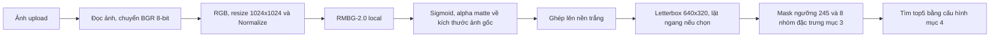

# Tách nền ảnh truy vấn bằng RMBG-2.0

## Phương pháp và nguồn

Tích hợp theo hai script trong [DucHai278/Fish-Image-Retrieval-System](https://github.com/DucHai278/Fish-Image-Retrieval-System/tree/158cbf1700f79794be2c9c75bad79d4980e20bd5/pre-processing-background-removal), commit `158cbf1700f79794be2c9c75bad79d4980e20bd5`:

- `rmbg - test process 1 image.py`
- `rmbg2 - test process many images in folder.py`

Các script dùng mô hình [BRIA RMBG-2.0](https://huggingface.co/briaai/RMBG-2.0) qua `AutoModelForImageSegmentation`, dự đoán alpha matte và ghép ảnh lên nền trắng. Project triển khai lại phương pháp thành module dùng chung cho web/CLI, không chạy trực tiếp script chứa token hard-code trong repo tham chiếu.

RMBG chỉ phục vụ **tiền xử lý ảnh upload**, không thay tám bộ mô tả thủ công bằng embedding học sâu. CSDL, ảnh gallery và trọng số mục 4 giữ nguyên. Ảnh dataset được chọn từ thư viện để thử tìm kiếm luôn bỏ qua RMBG nhằm bảo toàn chuẩn hóa và quy tắc loại trùng pixel.

## Cấu hình chính xác

File: `src/fish_features/background_profile.json`.

| Tham số | Giá trị |
|---|---|
| Phiên bản tiền xử lý query | `query-rmbg2-1.0.0` |
| Model | `briaai/RMBG-2.0` |
| Revision model và mã inference | `6a88d6a65119856a743be87ec1e6bee6f08e1f93` |
| Kích thước model | 1024×1024, đúng cách resize vuông trong repo nguồn |
| Thứ tự màu model | RGB |
| Mean | [0.485, 0.456, 0.406] |
| Std | [0.229, 0.224, 0.225] |
| Lấy dự đoán | `model(tensor)[-1].sigmoid()` |
| Resize mask | `ToPILImage`, sau đó `resize(image.size)` như repo nguồn |
| Ghép nền | Soft alpha: `image×alpha + 255×(1−alpha)` |
| Thiết bị mặc định | CPU, float32, 4 luồng torch |
| Canvas cho trích rút | 640×320, giữ tỉ lệ và letterbox trắng sau tách nền |

Máy hiện tại có GPU MX230 2 GB; chọn CPU để tránh giả định mô hình 1024×1024 chạy đủ bộ nhớ GPU. Mô hình chỉ nạp một lần cho mỗi tiến trình, dùng khóa để không chạy nhiều inference đồng thời trên cùng model. Sau khi sửa cấu hình hãy khởi động lại web. Ảnh được xử lý trên máy local, không gửi ảnh đến dịch vụ inference; lần đầu cần Internet tải model.

Mã nguồn model được Transformers nạp với `trust_remote_code=True`, theo repo nguồn và ví dụ chính thức; cả `revision` và `code_revision` cố định theo commit nêu trên, không tự dùng bản mới nhất.

## Luồng xử lý



Phân biệt hai mặt nạ hiển thị: **alpha matte từ RMBG** là dự đoán mềm để ghép nền; **mask dùng trích rút** là mặt nạ nhị phân tính từ ảnh nền trắng sau đưa về canvas chuẩn. Không dùng trực tiếp alpha thay mask của bộ trích rút để tránh âm thầm đổi định nghĩa đặc trưng của gallery.

## Cài đặt và đăng nhập

Model yêu cầu tài khoản Hugging Face được quyền truy cập. Quyền cấp trên trang model là điều kiện của nhà cung cấp; project không tự nhận điều khoản hoặc đăng nhập thay người dùng.

```powershell
# Tại thư mục gốc project:
.venv/Scripts/python -m pip install -r requirements-background.txt
.venv/Scripts/hf auth login
```

Dán token Hugging Face trực tiếp vào lời nhắc của terminal. Không ghi token vào source, `.env.example`, tài liệu hoặc gửi qua chat. Dùng tài khoản đã có quyền tại trang model. Nếu CLI hỏi thêm Git credential, không bắt buộc thêm vì chương trình tải model qua Hugging Face Hub, không dùng Git credential cho bước này.

Kiểm tra trạng thái mà chưa tải model:

```powershell
.venv/Scripts/python -m fish_features bg-check
```

Tải và nạp model trước để tránh đợi trong lần tìm đầu:

```powershell
.venv/Scripts/python -m fish_features bg-check --load
```

`state=loaded` xác nhận model đã nạp trong tiến trình kiểm tra; tiến trình web sẽ nạp lại từ cache lần đầu dùng. Trọng số có dung lượng lớn; hãy đợi lệnh hoàn tất. `needs_login` nghĩa là chưa có trọng số local và chưa có token. `not_loaded` chỉ nghĩa là có token/cache để thử, chưa xác nhận tài khoản có quyền tải. Nếu tài khoản chưa được cấp quyền, chương trình trả lỗi cụ thể để cấp quyền và đăng nhập, không tự chuyển sang model khác hoặc chạy tìm kiếm với nền sai.

## Sử dụng

Web: mở `http://127.0.0.1:8000`, mặc định bật **“Tách nền bằng RMBG-2.0, ghép nền trắng”** khi upload. Có thể bỏ chọn cho ảnh đã chuẩn hóa nền trắng. Sau xử lý, xem ảnh trước tách nền, alpha matte, ảnh nền trắng/canvas, mask nhị phân và đường bao. Kết quả JSON chứa tên model, revision, thiết bị, tham số chuẩn hóa và thời gian xử lý trong `preparation.background_removal`.

CLI:

```powershell
.venv/Scripts/python -m fish_features search test.jpg --background rmbg2 --output outputs/query-rmbg.json
```

CLI mặc định `--background none` để giữ quy trình cũ khi thử bằng ảnh dataset. Web gửi rõ lựa chọn `background=rmbg2` cho upload và `none` cho ảnh chọn bằng ID dataset.

## Kiểm chứng và giới hạn

Kiểm thử tự động xác nhận soft alpha ghép nền trắng đúng, RMBG được gọi trước resize canvas, preview giữ ảnh đầu vào, ảnh chuẩn bỏ qua model, lỗi model/credential không bị biến thành tìm kiếm bình thường, API truyền đúng chế độ và ảnh thư viện không chạy lại model. Các test này dùng alpha giả lập để kiểm tra luồng, không phải đo chất lượng RMBG.

Dependencies đã cài và kiểm tra import trên Python 3.14 với torch CPU. Sau khi người dùng đăng nhập Hugging Face, đã tải/nạp được đúng model và chạy **inference thật qua HTTP API** bằng `scripts/verify_background_inference.py`: lấy một ảnh cá dataset rồi thay phần nền trắng thành xám xanh để tái hiện lỗi.

Kết quả ảnh thử `species_101_cheilinus_chlorourus_936.png`: trước RMBG, mask chiếm 100% khung và có `mask_touches_border`, `unusual_occupancy`; sau RMBG, mask chiếm **27,6592%**, không còn hai cảnh báo, trả đủ 5 kết quả. Thời gian tách nền lần thử gồm nạp model trong tiến trình web khoảng **59,8 giây trên CPU**. Đây là một phép thử có kiểm soát, không phải chỉ số chất lượng trên toàn bộ ảnh mạng. Đã xem trực quan ảnh nền trắng và mask sau xử lý.

Ảnh đầu vào, alpha, ảnh nền trắng, mask, contour và JSON kết quả được lưu tại `outputs/background-check/`. Có thể chạy lại script trên khi web đang bật và model đã có quyền truy cập. `verify_background_result_ui.py` phát lại đúng response inference thật đã lưu để kiểm tra năm ảnh preview, top5 và bố cục điện thoại mà không phải infer lại. Các kiểm thử bằng stub vẫn được phân biệt rõ với lần inference thật này.

Mô hình phân đoạn chủ thể tổng quát, không nhận diện loài hoặc hướng đầu cá. Có thể giữ cả chữ, bóng, nhiều cá hoặc bỏ sót vây; luôn kiểm tra alpha và mask. Không tự căn chỉnh/cắt sát hoặc thay đổi tỷ lệ diện tích cá ngoài letterbox đã có. Các số liệu holdout mục 4 là của dataset chuẩn hóa, **không phải số liệu đánh giá mới cho query dùng RMBG trên ảnh mạng**.

Điều kiện truy cập và sử dụng model xem trực tiếp [trang model BRIA](https://huggingface.co/briaai/RMBG-2.0).
