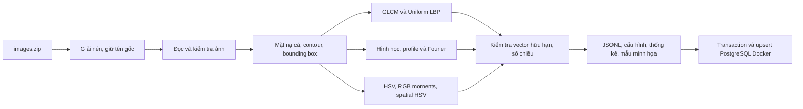
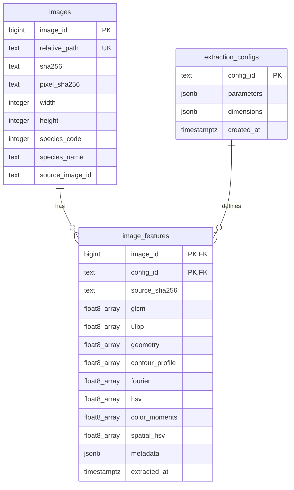

# Mục 3 — Triển khai trích rút và quản trị đặc trưng ảnh cá

## 3.1. Mục tiêu và cơ sở kế thừa

Theo mục 3 của đề bài, hệ thống cần triển khai các thuật toán/công cụ trích rút đặc trưng đã xác định ở bước 2 và xây dựng CSDL quản trị các đặc trưng của ảnh đã có. Mã nguồn này chuyển các phương pháp trong báo cáo thành quy trình chạy được trên toàn bộ dataset, lưu kết quả có cấu trúc và cho phép kiểm tra, cập nhật, tái lập.

Đầu vào là các ảnh trong `images.zip`; theo báo cáo, ảnh PNG RGB 640 × 320, nền trắng, một con cá nằm ngang, đầu hướng trái. Chương trình kiểm tra số kênh, kiểu 8-bit, kích thước, khả năng đọc ảnh và sự tồn tại của vùng đối tượng; hướng đầu và số cá trong ảnh vẫn dựa trên chuẩn hóa dataset, không được nhận biết tự động.

Tên ảnh thật là `species_<mã loài>_<tên loài>_<mã ảnh>.png`. Hệ thống giữ nguyên tên này và tách các trường metadata từ tên file; nhãn loài chỉ là thông tin nguồn, không phải kết quả phân loại của thuật toán. Không tự đồng nhất thứ tự tên file với các mã minh họa `0001–1000` trong báo cáo vì chưa có bảng đối chiếu.

Các tham số trong báo cáo chủ yếu là ví dụ phương pháp, chưa phải cấu hình tối ưu. Triển khai lựa chọn một cấu hình cơ sở có thể tái lập, lưu tất cả nhóm đặc trưng riêng biệt và cho phép thử cấu hình khác. Việc chứng minh hiệu quả truy hồi và chọn trọng số thuộc mục 4.

## 3.2. Kiến trúc và luồng dữ liệu

Tách trích xuất và nạp CSDL giúp kiểm tra kết quả trước khi lưu, trích xuất được ngay cả khi CSDL chưa khởi động và nạp lại mà không phải tính toán ảnh lần nữa. File JSONL là kết quả trung gian có thể đọc bằng các công cụ khác, PostgreSQL là nơi quản trị tập trung.

## 3.3. Tạo mặt nạ vùng cá

Kế thừa quy trình ở trang 29 và 60 của báo cáo:

1. Đọc ảnh bằng OpenCV; dù file nguồn là RGB, OpenCV giải mã thành BGR trong bộ nhớ. Các phép chuyển màu được chọn đúng quy ước này.
2. Pixel ứng viên thuộc cá nếu ít nhất một kênh nhỏ hơn 245. Nền gần trắng bị loại.
3. Giữ thành phần liên thông 8 hướng có số pixel lớn nhất để loại các đốm rời.
4. Lấp các lỗ kín bằng flood-fill nền trên ảnh có padding. Bước này giữ những vùng sáng nằm hoàn toàn bên trong silhouette.
5. Tìm contour ngoài bằng `RETR_EXTERNAL`, `CHAIN_APPROX_NONE`; lấy bounding box `(x,y,w,h)`.

Mặt nạ chung được dùng cho cả màu sắc, kết cấu và hình dạng. Diện tích `A` là số pixel mask bằng 1. Các vùng gần trắng thông ra ngoài hoặc vây mỏng vẫn có thể mất; giữ thành phần lớn nhất cũng có thể loại chi tiết đứt rời. Pipeline ghi tỷ lệ pixel giữ lại, occupancy và các cảnh báo: chạm biên ảnh, bỏ trên 2% pixel ứng viên, occupancy ngoài [0,05;0,8]. Đây là tín hiệu kiểm tra, không phải thước đo độ chính xác phân đoạn.

## 3.4. Triển khai các nhóm đặc trưng

| Nhóm lưu | Đối chiếu báo cáo | Cấu hình cơ sở | Số chiều |
|---|---|---|---:|
| `glcm` | 2.1.2, trang 10–18 | 32 mức xám, 4 độ dời, 5 thống kê mỗi độ dời | 20 |
| `ulbp` | 2.1.3–2.1.4, trang 18–28 | Circular LBP P=8, R=1, uniform giữ hướng | 59 |
| `geometry` | 2.2.3, trang 30–36 | Aspect Ratio, Solidity, Extent | 3 |
| `contour_profile` | 2.2.4, trang 36–41 | Khoảng cách đến tâm, 256 mẫu đều theo cung | 256 |
| `fourier` | 2.2.5, trang 41–48 | D2–D11, chuẩn hóa theo biên độ F1 | 10 |
| `hsv` | 2.3.2, trang 54–63 | Histogram 3D HSV 12×4×4, L1 | 192 |
| `color_moments` | 2.3.3, trang 63–73 | Mean, std, căn bậc ba có dấu trên RGB/255 | 9 |
| `spatial_hsv` | 2.3.4, trang 73–80 | 3 cột × 2 hàng trên bounding box, HSV mỗi ô | 1.152 |

Tổng cộng **1.701 giá trị số/ảnh** nếu tính cả profile dùng giải thích. Đây là tổng dung lượng mô tả của cấu hình cơ sở, không phải quyết định ghép tất cả thành một vector tìm kiếm. Các nhóm được lưu riêng để tránh vô tình áp dụng cùng thang đo và trọng số.

### GLCM

Chuyển BGR sang xám bằng OpenCV, lượng tử hóa `q = floor(gray × 32 / 256)`. Tạo bốn ma trận cho `(Δr,Δc)` lần lượt `(0,1),(-1,1),(-1,0),(-1,-1)`, tương ứng quy ước hướng ở trang 12. Giữ thứ tự cặp, không cộng ma trận chuyển vị. Chỉ đếm nếu cả hai pixel thuộc mask; do đó nền không tạo các cặp trắng chiếm ưu thế.

Mỗi ma trận đếm chia tổng cặp thành xác suất `P`. Tính theo thứ tự ASM, Contrast, Homogeneity, Correlation, Entropy; ghép theo thứ tự bốn độ dời thành 20 số. Entropy dùng log2, bỏ phần tử 0; correlation quy ước bằng 1 nếu phương sai biên bằng 0. Lưu số cặp hợp lệ từng hướng trong metadata. Lựa chọn 32 mức giúp ma trận gọn, bốn hướng giữ thông tin định hướng hoa văn; đây là quyết định triển khai, chưa được đánh giá tối ưu.

### Circular LBP và Uniform LBP

Tại tâm `(x,y)`, lấy 8 điểm `(x+R cos(2πp/8), y−R sin(2πp/8))`; điểm 0 ở bên phải, duyệt ngược chiều kim đồng hồ trên ảnh. Nội suy song tuyến tính các điểm không nguyên bằng NumPy. So sánh lân cận ≥ tâm cho bit 1, mã bằng tổng `bit[p] × 2^p`.

Chỉ giữ tâm mà tâm và tất cả pixel có trọng số nội suy dương thuộc vùng cá và nằm trong ảnh. Đây là quy tắc hạn chế ảnh hưởng đường biên và nền. Lưu số tâm hợp lệ. Tạo histogram Circular LBP 256 chiều làm dữ liệu trung gian của ảnh mẫu; không đưa histogram nguyên bản này vào bảng đặc trưng.

Đếm số chuyển bit theo vòng tròn. Với U≤2, 58 mã uniform được gán nhãn 0–57 theo thứ tự mã thập phân tăng dần. Các mã còn lại vào nhãn 58. Chuẩn hóa histogram bằng số tâm hợp lệ để tổng 59 thành phần bằng 1. Biến thể này giữ hướng, khác biến thể uniform bất biến quay chỉ có 10 bin khi P=8.

### Hình học và profile

`Aspect Ratio=w/h`; `Extent=A/(w×h)`; `Solidity=A/AH`. Bao lồi tính bằng `convexHull`, sau đó raster hóa lên cùng lưới ảnh để `AH` và `A` đều là diện tích pixel, đúng lưu ý trang 32. Thứ tự geometry cố định là Aspect Ratio, Solidity, Extent.

Contour được chuẩn hóa chiều duyệt theo chiều kim đồng hồ trên ảnh (trục y xuống), bắt đầu ở điểm trái nhất, nếu có nhiều điểm thì chọn điểm cao nhất. Nối kín contour rồi nội suy 256 điểm theo chiều dài cung, không lặp lại điểm đầu ở cuối. Tâm là trọng tâm diện tích của mask, không phải trung bình các điểm contour. Profile là khoảng cách từ từng điểm tới tâm, chia khoảng cách trung bình, có mean bằng 1. Lưu tọa độ 256 điểm cho các ảnh mẫu để đối chiếu.

### Fourier Descriptor

Tạo `z[n]=x[n]+j y[n]` từ cùng contour đã lấy mẫu. Dùng `numpy.fft.fft(z)/N`, phù hợp hệ số `1/N` trong báo cáo. Bỏ F0, lấy `Dk=abs(Fk)/abs(F1)` với k=2…11. Nếu biên độ F1 nhỏ hơn 1e−8 thì báo lỗi, không chia cho số gần 0 hoặc tạo NaN. Cấu hình chỉ dùng phía tần số dương để bám ví dụ báo cáo; hạn chế bỏ thông tin phía âm được giữ rõ khi đánh giá sau này. Biên độ không đủ tái tạo duy nhất hình dạng vì không giữ pha.

### HSV Histogram

Chuyển `COLOR_BGR2HSV` cho ảnh 8-bit: H trong [0,180), S,V trong [0,256). Chỉ lấy pixel thuộc mask. Với 12×4×4 bin: `qH=H//15`, `qS=S//64`, `qV=V//64`. Chỉ số trải phẳng là `(qH×4+qS)×4+qV`, V thay đổi nhanh nhất, rồi S và H. Đếm 192 bin và chia tổng pixel cá, tổng histogram bằng 1.

Giữ HSV và quy ước bin giống minh họa báo cáo để dễ tái lập; chưa xử lý đặc biệt tính chu kỳ của Hue hay gộp vùng bão hòa thấp. Các giới hạn này cần xem xét trong mục 4.

### Color Moment

Đổi các pixel BGR được chọn sang thứ tự RGB và chia 255. Trên từng kênh tính `μ=mean(x)`, `σ=sqrt(mean((x−μ)^2))`, `τ=cbrt(mean((x−μ)^3))`. Dùng mẫu số N và căn bậc ba thực giữ dấu âm. Không dùng hệ số skewness `m3/σ³` thay cho τ.

Thứ tự 9 thành phần: `[μR,μG,μB,σR,σG,σB,τR,τG,τB]`, đúng trang 67. RGB được chọn theo thực nghiệm báo cáo và tránh phải lấy trung bình góc Hue.

### Spatial Color Histogram

Chia bounding box thành 3 cột × 2 hàng; phần dư phép chia nguyên đưa vào cột/hàng cuối, đúng quy ước trang 74. Duyệt hàng trên trái→phải R1–R3, rồi hàng dưới R4–R6. Mỗi ô chỉ thống kê pixel mask, cùng cấu hình 192 bin HSV như toàn cục. Chuẩn hóa riêng mỗi ô; vector ghép 1.152 số có tổng bằng số ô không rỗng, thường bằng 6, không phải bằng 1.

Ô rỗng được lưu histogram toàn 0, số pixel bằng 0 và cảnh báo `empty_spatial_region`. Số pixel từng ô lưu trong metadata để bước truy hồi biết ô nào thiếu dữ liệu. Khi làm mục 4 phải đặt quy tắc riêng cho ô rỗng, không áp dụng Hellinger phân bố chuẩn hóa vào vector toàn 0 và không mặc định hai ô thiếu là hoàn toàn giống nhau.

## 3.5. Thiết kế CSDL PostgreSQL

`images` quản lý ảnh nguồn, đường dẫn duy nhất và hai hash: hash file để nhận biết thay đổi nội dung file; hash pixel để phát hiện trùng nội dung ảnh dù cách mã hóa file có thể khác. `image_id` là định danh CSDL tự sinh, không phải mã minh họa trong PDF.

`extraction_configs` quản lý thuật toán, tham số, số chiều. `config_id` là SHA-256 của JSON cấu hình có thứ tự khóa ổn định, bao gồm phiên bản thuật toán. Một ảnh có thể có nhiều bộ đặc trưng tương ứng nhiều cấu hình.

`image_features` có khóa chính kép `(image_id,config_id)`, tám cột vector `double precision[]`, metadata JSONB và thời gian trích xuất. `source_sha256` liên kết kết quả với đúng phiên bản file ảnh. Trigger kiểm tra mỗi vector một chiều, bắt đầu từ index 1, đủ số phần tử theo cấu hình, không chứa NULL/NaN/vô cực. Không dựa vào khai báo `float8[59]` vì PostgreSQL không tự cưỡng chế độ dài mảng khai báo.

Metadata chứa diện tích, diện tích hull, centroid, bbox, occupancy, tỷ lệ thành phần giữ lại, số cặp GLCM, số tâm LBP, số pixel spatial và danh sách cảnh báo. View `feature_catalog` chỉ hiển thị bộ đặc trưng khớp hash hiện tại, cung cấp tên ảnh và ba chỉ số hình học để dễ xem. Có index trên nhãn loài và hash pixel; chưa tạo chỉ mục khoảng cách vector ở mục 3.

Ảnh PNG được giữ ở `data/images`; CSDL lưu đường dẫn tương đối. Cách này giảm việc lưu lặp dữ liệu ảnh, phù hợp quy mô bài tập và thuận tiện mở ảnh minh họa. Khi sao lưu/chuyển máy phải giữ cả dataset và CSDL.

## 3.6. Nạp dữ liệu, cập nhật và kiểm tra

Lệnh `db-init` tạo schema có thể chạy lại. `db-load` đọc manifest cấu hình cùng file JSONL, kiểm tra mã cấu hình, mở một transaction cho cả lần nạp. Upsert ảnh theo đường dẫn; nếu hash ảnh đổi thì loại các bộ đặc trưng cũ không còn tương ứng. Upsert đặc trưng theo ảnh+cấu hình; nạp lặp không nhân đôi. Nếu một bản ghi không hợp lệ, rollback cả lần nạp.

Khóa ngoại ngăn đặc trưng không có ảnh/cấu hình. Xóa ảnh dùng `ON DELETE CASCADE` để xóa các vector liên quan. Có thể xem chi tiết qua `db-inspect`, đếm ảnh và bộ đặc trưng qua `db-stats`, hoặc thao tác SQL trực tiếp như `sql/examples.sql`.

CSDL chạy dịch vụ `db` từ image `postgres:17`, có healthcheck `pg_isready`, cổng local 5433, volume lưu dữ liệu độc lập container. `docker compose up -d --wait` đợi sẵn sàng trước khi nạp. Thông tin kết nối Python đặt bằng `DATABASE_URL`.

## 3.7. Kiểm chứng và giới hạn

Kiểm thử tự động dùng ma trận GLCM trong báo cáo để kiểm tra cả năm thống kê; kiểm tra loại cặp có nền, nội suy LBP, ánh xạ đủ 59 nhãn, mask lấp lỗ/loại nhiễu, hình học trên hình chữ nhật biết trước, thứ tự RGB và histogram HSV, moment âm, phủ pixel spatial và ô rỗng. Kết quả chạy dataset và kiểm tra CSDL được ghi riêng ở `docs/verification.md`.

Chạy thành công không đồng nghĩa đặc trưng phân biệt tốt mọi loài hoặc mặt nạ hoàn hảo. Cần xem mặt nạ các ảnh sáng/vây mỏng, đánh giá độ ổn định, lựa chọn cấu hình và chuẩn hóa theo tập tham chiếu khi triển khai truy hồi. Các giá trị hình học và GLCM chưa chuẩn hóa theo phân bố toàn dataset vì mục 3 lưu đặc trưng gốc; không nên lấy khoảng cách Euclid trực tiếp trên toàn bộ 1.701 số để xếp hạng.

### Ví dụ đầu ra trên một ảnh thực tế

Với `species_101_cheilinus_chlorourus_936.png`, cấu hình mặc định thu được:

| Đại lượng | Giá trị |
|---|---:|
| Diện tích cá A | 56.947 pixel |
| Diện tích bao lồi raster AH | 65.324 pixel |
| Bounding box (x,y,w,h) | (101, 51, 438, 218) |
| Aspect Ratio | 2,009174 |
| Solidity | 0,871762 |
| Extent | 0,596404 |
| Số tâm LBP hợp lệ | 55.289 |
| Số cặp GLCM bốn hướng | 56.600; 56.351; 56.463; 56.362 |

Các số này lấy từ pipeline trên ảnh gốc trong ZIP, không phải sao chép bảng minh họa trong PDF. Mặt nạ và đường bao nằm ở `outputs/default/samples/species_101_cheilinus_chlorourus_936/`; các vector đầy đủ ở JSONL và CSDL. Có thể minh họa ba phép tính `438/218`, `56947/65324` và `56947/(438×218)` để kiểm tra các chỉ số hình học.

## Tài liệu đối chiếu triển khai

- `BaoCao_BTL.pdf`, chương 2, là cơ sở phương pháp và quy ước của project.
- [OpenCV — Contour Features](https://docs.opencv.org/4.x/dd/d49/tutorial_py_contour_features.html): contour, bounding rectangle, convex hull.
- [PostgreSQL 17 — Arrays](https://www.postgresql.org/docs/17/arrays.html): lưu mảng và giới hạn khai báo kích thước; triển khai bổ sung trigger cưỡng chế.
- [Docker Compose — Startup order](https://docs.docker.com/compose/how-tos/startup-order/): healthcheck và trạng thái sẵn sàng của dịch vụ.
