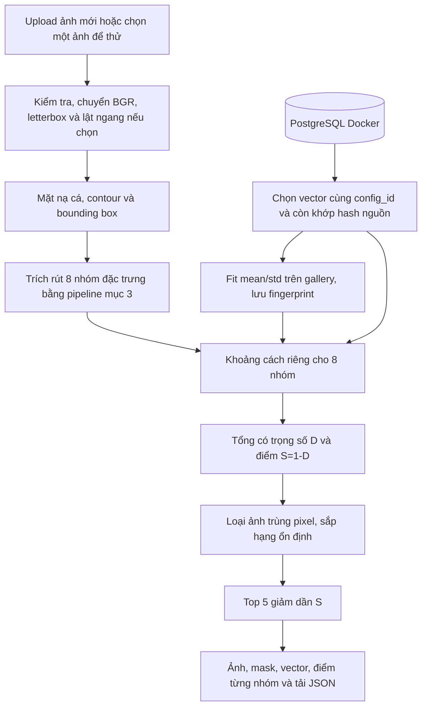

# Mục 4 — Tìm kiếm 5 ảnh cá tương đồng theo nội dung

**Bổ sung tiền xử lý ảnh upload:** đã tích hợp RMBG-2.0 để tách nền ảnh mạng theo repo DucHai278; xem [background-removal.md](background-removal.md) và `src/fish_features/background_profile.json`. Các tham số và số liệu dưới đây mô tả cấu hình truy hồi đã đánh giá trên dataset chuẩn hóa. Chúng không phải đánh giá chất lượng ảnh mạng sau RMBG. Khi tắt tách nền, các yêu cầu nền trắng dưới đây vẫn áp dụng.

## 4.1. Mục tiêu và phạm vi

Theo `assignment.txt`, hệ thống nhận một ảnh mới chứa một con cá, trả về 5 ảnh có nội dung tương đồng nhất, xếp giảm dần độ tương đồng. Kết quả cần có sơ đồ khối, mô tả đầu vào/đầu ra các module, minh họa giá trị trung gian và đánh giá.

Triển khai trên nhánh `main`, dùng lại toàn bộ pipeline mục 3 và PostgreSQL Docker. Nhánh `task/3.0` giữ bản mục 3. Hệ thống tìm kiếm theo màu, hình dạng, kết cấu; tên loài trong tên file không tham gia tính điểm hay lọc kết quả. Cá khác loài vẫn có thể có điểm tương đồng cao; ảnh truy vấn thuộc loài chưa có trong gallery vẫn được xử lý và trả về các ảnh gần nhất.

Phần mô tả và xếp hạng dùng đặc trưng thủ công, không dùng embedding học sâu, không huấn luyện phân loại và không dùng chỉ mục gần đúng. RMBG-2.0, khi bật, chỉ dùng để tiền xử lý nền ảnh upload. Với 1.000 ảnh, chương trình nạp vector đúng cấu hình từ CSDL và tính chính xác khoảng cách với tất cả ứng viên bằng NumPy.

## 4.2. Sơ đồ khối và chức năng từng module — yêu cầu 4a



| Module | Mã nguồn | Đầu vào | Đầu ra |
|---|---|---|---|
| Nhận ảnh và chuẩn hóa | `query.py: prepare_image` | Byte ảnh, lựa chọn lật, cấu hình | BGR uint8 640×320, thông tin thay đổi kích thước |
| Phân đoạn và trích rút | `extractor.py: extract_array` cùng các module mục 3 | Canvas chuẩn, cấu hình | 8 vector, mask metadata, hash pixel |
| Đọc gallery | `retrieval.py: fetch_records` | config_id, PostgreSQL | Vector, thông tin ảnh và cấu hình khớp |
| Chuẩn hóa, tính khoảng cách | `retrieval.py: Index` | Gallery và vector query | Thống kê gallery, 8 khoảng cách/ứng viên |
| Kết hợp, xếp hạng | `Index.rank` | Khoảng cách, trọng số | 5 ảnh, D, S và đóng góp từng nhóm |
| API và hiển thị | `web.py`, `web_static/retrieval.js` | Upload hoặc ID ảnh, kết quả tìm kiếm | Giao diện local và JSON kết quả |
| Đánh giá | `evaluation.py` | Đặc trưng và nhãn từ CSDL | Split, kết quả validation/test, trọng số được chọn |

Các vector gallery được cache theo `(config_id, count, max(extracted_at), max(updated_at))`. Nạp/cập nhật dữ liệu làm thay đổi phiên bản cache; chương trình tạo index và thống kê mới. Không ghi vector truy vấn vào bảng ảnh hoặc sửa đặc trưng mục 3.

## 4.3. Cấu hình trích rút sử dụng

Giữ nguyên cấu hình mục 3, không trích lại dataset bằng phương pháp khác:

| Tham số | Số chiều | Giá trị |
|---|---:|---|
| Phiên bản thuật toán trích rút | — | `1.0.0` |
| Kích thước ảnh | — | 640×320, RGB nguồn/BGR trong OpenCV, 8-bit |
| Tách nền | — | Ít nhất một kênh <245; thành phần liên thông lớn nhất; lấp lỗ kín |
| GLCM | 20 | 32 mức xám; độ dời `(0,1),(-1,1),(-1,0),(-1,-1)`; không đối xứng hóa; cả hai pixel thuộc mask |
| Thống kê GLCM | — | ASM, Contrast, Homogeneity, Correlation, Entropy cho mỗi độ dời; 5 thống kê × 4 độ dời tạo 20 chiều đã tính ở hàng GLCM |
| Circular Uniform LBP | 59 | P=8, R=1, nội suy bilinear, uniform giữ hướng |
| Geometry | 3 | Aspect Ratio, Solidity, Extent; diện tích cùng quy ước raster |
| Contour Profile | 256 | 256 mẫu đều theo cung, chuẩn hóa khoảng cách bằng trung bình |
| Fourier | 10 | 256 điểm; D2–D11 chia biên độ F1 |
| HSV toàn cục | 192 | 12×4×4 bin, chuẩn hóa L1 |
| Color Moment | 9 | RGB/255; mean, std tổng thể, căn bậc ba có dấu |
| Spatial HSV | 1.152 | Bounding box 3 cột×2 hàng; 192 bin/ô, L1 riêng từng ô |
| **Tổng 8 nhóm đặc trưng** | **1.701** | Lưu riêng từng nhóm để tính khoảng cách và kết hợp trọng số |

Dấu “—” chỉ thông số cấu hình hoặc phần diễn giải, không phải một vector riêng để cộng vào tổng số chiều.

Mã cấu hình trích rút:

```text
dee14083f1e017e28de89081ea10c392b830bb7331a19d6e70459a809c9ee484
```

Ảnh truy vấn phải mô tả một con cá, nền trắng, nằm ngang và đầu hướng trái tương tự dataset. Hệ thống không nhận diện hướng đầu; người dùng chọn “Lật ngang” nếu đầu cá đang hướng phải. Upload nhận ảnh 8-bit tối đa 10 MiB; từ chối ảnh không giải mã được hoặc quá 20 megapixel sau giải mã. Ảnh xám được đổi sang ba kênh; alpha được ghép trên nền trắng. Không tự hiệu chỉnh xoay theo EXIF.

Nếu kích thước khác 640×320, co giãn toàn ảnh giữ tỉ lệ với hệ số `min(640/W,320/H)`, đặt giữa canvas trắng; khi giảm dùng `INTER_AREA`, khi tăng dùng `INTER_LINEAR`. Ảnh đã đúng kích thước giữ nguyên pixel, trừ khi chọn lật ngang. Không tự cắt sát cá hay hiệu chỉnh tỉ lệ diện tích cá; khác biệt khung hình có thể ảnh hưởng GLCM/LBP và chất lượng truy hồi. Hãy kiểm tra mask hiển thị.

## 4.4. Độ đo và chuẩn hóa

Mỗi nhóm cho khoảng cách trong [0,1]. Không lấy Euclid trực tiếp trên vector ghép 1.701 chiều vì số chiều và thang giá trị giữa các nhóm rất khác nhau.

### Histogram HSV và Uniform LBP

Dùng Hellinger trên hai phân bố L1 `p,q`:

```text
dH(p,q) = sqrt( sum((sqrt(p_i) - sqrt(q_i))²) / 2 )
```

Công thức tương đương `sqrt(1−sum(sqrt(p_i*q_i)))` khi hai histogram có tổng 1, nhưng tránh sai số triệt tiêu khi hai phân bố rất gần nhau.

### Spatial HSV

Tính Hellinger ở mỗi cặp ô tương ứng và lấy trung bình các ô thuộc hợp các ô có dữ liệu:

- Hai ô đều có pixel: dùng Hellinger.
- Chỉ một ô có pixel: khoảng cách ô bằng 1.
- Cả hai ô rỗng: bỏ ô khỏi trung bình, không tính là một cặp tương đồng hoàn hảo.
- Nếu không có ô hợp lệ nào: khoảng cách cả nhóm bằng 1.

Với dataset hiện tại, sáu ô đều có pixel nên đây là trung bình Hellinger của cả sáu vùng như báo cáo mục 2.

### GLCM, geometry, Fourier và Color Moment

Trên gallery tham chiếu, tính mean và độ lệch chuẩn tổng thể (ddof=0) riêng từng thành phần. Nếu std<1e−8, thay std bằng 1 để tránh chia số quá nhỏ. Query không tham gia fit thống kê.

```text
z_g,i = (x_g,i − mean_i) / std_i
z_q,i = (x_q,i − mean_i) / std_i
r = sqrt(mean((z_g − z_q)²))
d = r / (1+r)
```

Vì cùng mean, phép trừ thực hiện trực tiếp bằng `(x_g−x_q)/std`. Lưu mean/std trong JSON kết quả để minh bạch và có thể tái lập. `raw_rms` là RMS sau bước chia std, trước phép ánh xạ `r/(1+r)`, không phải RMS trên giá trị gốc chưa chuẩn hóa.

Khi đánh giá, thống kê chỉ fit trên 530 ảnh gallery, không dùng 208 query validation hoặc 262 query test. Khi vận hành, fit trên toàn bộ 1.000 ảnh gallery vì đây là tập tham chiếu thực tế. Hai bối cảnh có thống kê và không gian ứng viên khác nhau; không trộn số liệu test với điểm truy vấn live.

### Contour Profile

Các profile đã có mean khoảng cách bằng 1 và cùng 256 điểm, cùng chiều duyệt và điểm bắt đầu. Tính RMS trực tiếp giữa hai profile, sau đó `d=r/(1+r)`; không chia thêm std gallery cho profile. Nhạy với sai lệch vị trí bắt đầu/vây được xem là giới hạn của nhóm này.

## 4.5. Trọng số chính thức đang dùng

File cấu hình có hiệu lực: **`src/fish_features/retrieval_profile.json`**, phiên bản `retrieval-1.0.0`. Có thể đọc cấu hình ngay trên giao diện hoặc tải JSON kết quả để biết chính xác lần chạy đã sử dụng gì.

| Nhóm | Trọng số |
|---|---:|
| HSV toàn cục | 0,100 =10% |
| Spatial HSV | 0,075 =7,5% |
| Color Moment | 0,025 =2,5% |
| Geometry | 0,200 =20% |
| Fourier | 0,300 =30% |
| Contour Profile | 0,100 =10% |
| GLCM | 0,100 =10% |
| Uniform LBP | 0,100 =10% |
| **Tổng** | **1,000** |

Gộp theo loại: **màu sắc 20%, hình dạng 60%, kết cấu 20%**. Trọng số này được chọn theo validation, không tự thay đổi theo ảnh truy vấn.

```text
D(Q,I) = Σ nhóm w_g * d_g(Q,I)
S(Q,I) = 1 − D(Q,I)
```

Khoảng cách thấp hơn tương ứng điểm S cao hơn. Xếp tăng dần D (tương đương giảm dần S), lấy 5 ảnh đầu. Khi bằng điểm, giữ thứ tự đường dẫn tên file để tái lập. Không diễn giải S là xác suất cùng loài hoặc tỷ lệ phần trăm giống nhau.

Tự loại những ảnh gallery có cùng SHA-256 pixel với query sau chuẩn hóa, tránh chính ảnh query đứng đầu khi thử bằng dataset. Không loại chỉ dựa vào tên file hay nhãn loài. Ảnh mới sau JPEG/resize có thể khác pixel và không bị loại, dù có cùng nguồn thị giác. Với ảnh mới thật sự và gallery đủ 1.000 ảnh, thông thường sẽ có 1.000 ứng viên; với query trùng một ảnh dataset, thường còn 999.

## 4.6. Minh họa kết quả trung gian — yêu cầu 4b

Ví dụ dùng `species_101_cheilinus_chlorourus_936.png` làm query trên gallery đầy đủ. Pipeline trích lại ảnh query, không lấy vector theo nhãn tên file. Query có diện tích mask 56.947 pixel, bbox `(101,51,438,218)`, geometry `[2,009174;0,871762;0,596404]`. Các vector query được kiểm tra khớp chính xác với bộ đã lưu trong CSDL; ảnh trùng pixel bị loại trước khi trả top 5.

| Hạng | Ảnh kết quả | D | S |
|---:|---|---:|---:|
| 1 | `species_294_macropharyngodon_meleagris_2797.png` | 0,287973 | 0,712027 |
| 2 | `species_118_choerodon_graphicus_1091.png` | 0,288643 | 0,711357 |
| 3 | `species_118_choerodon_graphicus_1092.png` | 0,294243 | 0,705757 |
| 4 | `species_324_oxycheilinus_bimaculatus_3021.png` | 0,304762 | 0,695238 |
| 5 | `species_115_choerodon_cauteroma_1055.png` | 0,313815 | 0,686185 |

Đối với ảnh hạng 1:

| Nhóm | RMS trước ánh xạ nếu có | d đã chuẩn hóa | w | w×d |
|---|---:|---:|---:|---:|
| GLCM | 0,349436 | 0,258950 | 0,100 | 0,025895 |
| Uniform LBP | — | 0,041789 | 0,100 | 0,004179 |
| Geometry | 0,159819 | 0,137797 | 0,200 | 0,027559 |
| Contour Profile | 0,204073 | 0,169485 | 0,100 | 0,016949 |
| Fourier | 0,625119 | 0,384660 | 0,300 | 0,115398 |
| HSV | — | 0,497799 | 0,100 | 0,049780 |
| Color Moment | 0,362179 | 0,265882 | 0,025 | 0,006647 |
| Spatial HSV | — | 0,554220 | 0,075 | 0,041566 |

Ví dụ `d_geometry = 0,159819/(1+0,159819) ≈ 0,137797`. Tổng các đóng góp với giá trị chưa làm tròn bằng `D≈0,287973277`, suy ra `S≈0,712026723`.

Năm kết quả này không cùng mã loài với query. Điều đó vừa thể hiện hệ thống không lọc nhãn loài, vừa là ví dụ giới hạn khi xem nhãn loài là relevance: không nên chỉ chọn các ví dụ đẹp để báo cáo. Cần đối chiếu trực quan và số liệu đánh giá trên toàn tập test.

Giao diện hiển thị ảnh query đã chuẩn hóa, mask, contour, top 5; mỗi kết quả có bảng khoảng cách và đóng góp từng nhóm. Phần “Đối chiếu các giá trị trung gian” cung cấp toàn bộ vector query và cả năm kết quả; phần cấu hình cung cấp mean/std gallery, fingerprint, tham số tiền xử lý và metadata. Nút tải JSON giữ tất cả số chưa làm tròn. Dữ liệu CLI tương tự nằm ở `outputs/query.json` sau lệnh demo trong README. Bản minh họa số liệu đầy đủ được lưu trong Git ở `docs/task4_example.json` (bỏ các ảnh preview base64 để giữ file gọn).

## 4.7. Đánh giá — yêu cầu 4c

### Protocol và dữ liệu

Nguồn đánh giá là 1.000 ảnh với 323 mã loài từ tên file. Dùng NumPy `default_rng(42)` trên danh sách loài và tên file đã sắp để chia xác định:

- Loài có ít nhất 3 ảnh: 1 query test, 1 query validation, còn lại vào gallery.
- Loài có đúng 2 ảnh: 1 query test và 1 ảnh gallery; không có query validation.
- Loài có 1 ảnh: chỉ vào gallery vì không có ảnh cùng loài khác để làm relevance.

Kết quả: **530 gallery, 208 validation, 262 test**, ba tập không giao nhau. Có 61 loài singleton chỉ trong gallery. Gallery đảm bảo mỗi query đánh giá có ít nhất một ảnh cùng mã loài. Loại ảnh trùng pixel, fit scaler trên gallery, tìm trong gallery bằng cùng phương pháp với vận hành.

Dataset fingerprint:

```text
16f0dc3e0a545ddee0a4b05220055b133609e6d941ed8b6c7dee0428674c734f
```

Fingerprint được tính từ config_id và danh sách có thứ tự `(path,sha256)`; giúp phát hiện dataset thay đổi. Danh sách từng split được xuất ở `outputs/evaluation/splits.json`; toàn bộ kết quả từng query ở `validation_queries.json` và `test_queries.json`. Tóm tắt kiểm chứng được lưu trong Git tại `docs/task4_evaluation.json`.

### Chọn trọng số trên validation

Cố định tỷ lệ trong mỗi nhóm lớn: màu = HSV 1/2, spatial 3/8, moments 1/8; hình dạng = geometry 1/3, Fourier 1/2, profile 1/6; kết cấu = GLCM và LBP mỗi loại 1/2. Thử 8 phương án nhóm lớn, chọn mAP@5 validation cao nhất, không dùng test để lựa chọn:

| Phương án màu / dạng / kết cấu | mAP@5 validation | Hit@5 validation |
|---|---:|---:|
| 100 / 0 / 0 | 0,075735 | 0,201923 |
| 0 / 100 / 0 | 0,105061 | 0,278846 |
| 0 / 0 / 100 | 0,044952 | 0,120192 |
| 1/3 / 1/3 / 1/3 | 0,135243 | 0,307692 |
| 40 / 30 / 30 | 0,131851 | 0,288462 |
| 60 / 20 / 20 | 0,118737 | 0,259615 |
| **20 / 60 / 20** | **0,152337** | **0,375000** |
| 20 / 20 / 60 | 0,119872 | 0,254808 |

Đây là phương án tốt nhất trong 8 cấu hình thử với cùng cấu hình trích rút, chưa phải tối ưu trên mọi tham số. Chưa khảo sát thêm số bin HSV, số mức xám hoặc hệ số Fourier khác; không được kết luận các thông số trích rút mục 3 là tối ưu.

### Chỉ số

Relevant được định nghĩa là cùng `species_code` lấy từ tên file. Mỗi query có R ảnh relevant trong gallery; không dùng nhãn khi xếp hạng.

- `Precision@5 = số relevant trong top5 /5`.
- `Recall@5 = số relevant trong top5 /R`.
- `Hit@5 =1` nếu có ít nhất một relevant trong top5, ngược lại 0.
- `AP@5 = Σ(k=1..5) P@k × rel(k) / min(R,5)`. **mAP@5** là trung bình AP@5 các query. Báo cáo dùng mẫu số `min(R,5)` cho AP cắt ngọn; cần giữ quy ước này khi so với thư viện khác.
- `nDCG@5`: gain nhị phân, DCG bằng `Σrel(k)/log2(k+1)`; IDCG tương ứng `min(R,5)` kết quả relevant ở đầu.

Các chỉ số báo cáo đều lấy trung bình theo query. Test có một query mỗi loài đủ điều kiện nên cũng cân bằng các loài có từ hai ảnh trở lên. Precision@5 chịu giới hạn bởi số ảnh cùng loài ít; không đồng nhất Hit@5 với tỷ lệ cả năm ảnh đúng.

### Kết quả test độc lập

| Phương án | P@5 | Recall@5 | Hit@5 | mAP@5 | nDCG@5 |
|---|---:|---:|---:|---:|---:|
| **Kết hợp đã chọn** | **0,110687** | **0,324427** | **0,477099** | **0,228255** | **0,278866** |
| Chỉ màu | 0,048092 | 0,138041 | 0,213740 | 0,099650 | 0,122248 |
| Chỉ hình dạng | 0,076336 | 0,216285 | 0,320611 | 0,145367 | 0,181829 |
| Chỉ kết cấu | 0,035878 | 0,104326 | 0,164122 | 0,065744 | 0,084318 |
| Ba nhóm bằng nhau | 0,093893 | 0,275445 | 0,408397 | 0,194922 | 0,238573 |

Phương án kết hợp tốt hơn các phương án đối chiếu trong lần chia này, nhưng độ chính xác theo nhãn loài còn hạn chế: khoảng 47,71% query có ít nhất một ảnh cùng loài trong top5; P@5 chỉ khoảng 11,07%. Không nên mô tả hệ thống là nhận dạng loài chính xác cao.

Đã thử thêm 3 query với toàn bộ mã loài của query bị loại khỏi gallery để mô phỏng loài chưa có. Hệ thống vẫn trả top5 và điểm đầy đủ, không áp dụng ngưỡng từ chối; các ví dụ ở `unseen_species_examples` trong báo cáo JSON. Đây là kiểm tra hoạt động, không có relevance cùng loài để tính accuracy hoặc chứng minh chất lượng open-set.

### Giới hạn

- Cùng loài là proxy: cá khác loài vẫn có thể giống về dáng/màu, cá cùng loài vẫn có thể khác về tuổi, giới tính hoặc ánh sáng. Chưa có nhãn relevance thị giác thủ công.
- Chỉ có một lần chia seed42; chưa có khoảng tin cậy hoặc kiểm định khác biệt giữa phương án.
- Giữ gallery tối thiểu một ảnh/loài giúp đo closed-set trên các loài đủ ảnh; không đại diện đầy đủ cho phân bố ảnh thực tế ngoài dataset.
- Các đặc trưng thủ công có thể mất thông tin; Fourier chỉ lấy hệ số dương D2–D11, histogram mất vị trí chi tiết, mặt nạ gần trắng có thể bỏ sót vây mỏng.
- Truy vấn ngoài chuẩn hóa, nền phức tạp, cá nghiêng/che khuất có thể làm kết quả kém. Có thể bật RMBG-2.0 cho upload có nền, nhưng vẫn phải kiểm tra chất lượng mask; đánh giá holdout ở đây không đo riêng luồng ảnh mạng này.
- Số liệu được đo trên gallery530, khác vận hành gallery1000. Không coi kết quả tự truy vấn trên toàn dataset là độ chính xác test.

## 4.8. Cách chạy và tái lập

```powershell
docker compose up -d --wait
.venv/Scripts/python -m fish_features.web
```

Mở `http://127.0.0.1:8000`, chọn ảnh, chỉnh tùy chọn lật nếu cần và bấm “Tìm 5 ảnh tương đồng”. Hoặc mở chi tiết một ảnh dataset và bấm “Dùng ảnh này tìm tương đồng”; ảnh trùng pixel sẽ không xuất hiện trong kết quả.

```powershell
# CLI: kết quả chứa cả top5, vector, thống kê và cấu hình.
.venv/Scripts/python -m fish_features search data/images/species_101_cheilinus_chlorourus_936.png --output outputs/query.json
# Query đầu hướng phải:
.venv/Scripts/python -m fish_features search anh-moi.jpg --flip --output outputs/query-flipped.json
# Chạy lại đánh giá và xuất mọi split/kết quả:
.venv/Scripts/python -m fish_features evaluate --output outputs/evaluation
```

`evaluate` chỉ tạo báo cáo và `selected_profile.json` trong thư mục output, **không tự sửa cấu hình đang chạy**. Muốn dùng phương án được chọn, đối chiếu rồi sao chép `outputs/evaluation/selected_profile.json` sang `src/fish_features/retrieval_profile.json`. Hoặc dùng CLI `search --profile <đường dẫn JSON>` để thử riêng. Khi thay thuật toán/khoảng cách, phải đổi phiên bản và đánh giá lại; sửa tên cấu hình không tự thay thuật toán.

## Tài liệu tham khảo triển khai

- `assignment.txt`, yêu cầu 4a–4c; `BaoCao_BTL.pdf`, chương 2; `docs/muc3.md`.
- [NumPy — Standard deviation](https://numpy.org/doc/stable/reference/generated/numpy.std.html): cách tính độ lệch chuẩn tổng thể `ddof=0` được dùng để fit gallery.
